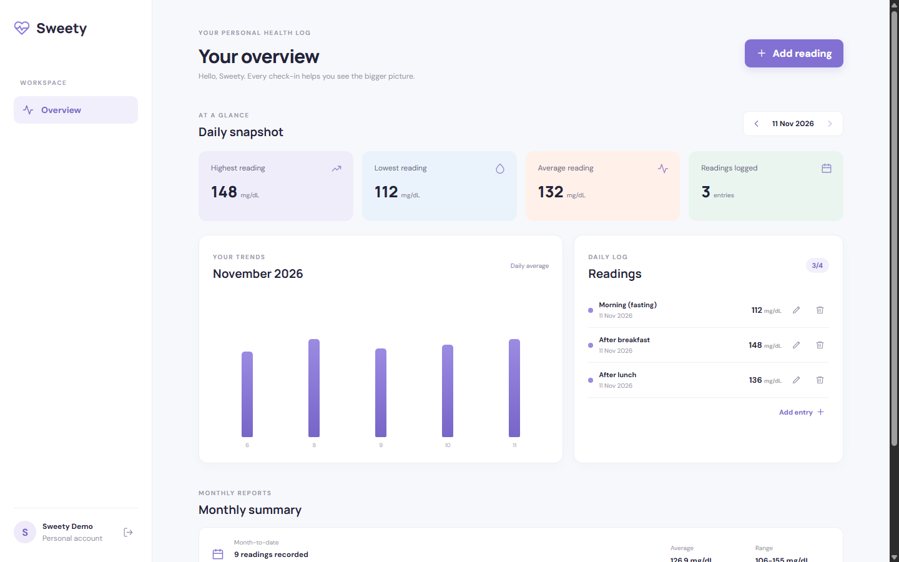
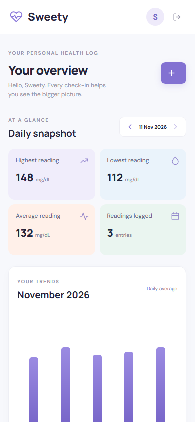

# Sweety - Blood Glucose Tracker

A full-stack blood glucose tracking application built for the Kenpath Junior Full Stack Developer assignment.

## Tech stack

- Frontend: React 18 and Vite
- Backend: Node.js and Express
- Database: PostgreSQL
- Authentication: JWT and bcrypt password hashing
- HTTP client: Axios
- Testing: Node.js test runner, Supertest, and Vitest

## Features

- Register and sign in with name, email, and password.
- Store passwords as bcrypt hashes; never return password hashes from authentication responses.
- Keep each user's readings private through authenticated, user-scoped API queries.
- Create, view, edit, and delete glucose readings.
- Record four daily slots: Morning (fasting), After breakfast, After lunch, and After dinner.
- Validate required values, integer values from 40 to 600 mg/dL, valid dates, and no future dates.
- Enforce one reading per slot per day and a maximum of four readings per user per day.
- Use a PostgreSQL unique constraint and transaction-level advisory locks to protect concurrent creates.
- Display daily highest, lowest, average (rounded to one decimal place), and reading count.
- Display month-to-date and previous-calendar-month summaries.
- Show a daily log and a monthly trend chart.
- Provide a paginated readings API.
- Responsive layout for mobile, tablet, laptop, and desktop screens.

## Screenshots

### Desktop dashboard


### Mobile dashboard


## Prerequisites

- Node.js 20.6 or newer
- npm 10 or newer
- PostgreSQL 14 or newer

## Local setup

1. Clone the repository and open its root directory.
2. Create a PostgreSQL database named `sweety` (owner: your local PostgreSQL user).
3. Copy `.env.example` to `.env` in the repository root.
4. Update `DB_HOST`, `DB_PORT`, `DB_NAME`, `DB_USER`, and `DB_PASSWORD` for your PostgreSQL installation.
5. Set `JWT_SECRET` to a random secret with at least 32 characters.
6. Set `DEMO_PASSWORD` to a local demo password of at least 8 characters.
7. Install dependencies from the repository root:

   ```bash
   npm install
   ```

8. Create the demo account and sample readings:

   ```bash
   npm run seed
   ```

9. Start the API and frontend together:

   ```bash
   npm run dev
   ```

The frontend is available at http://localhost:5173 and the API at http://localhost:5000. The API creates the required tables and index on startup.

### Environment variables

| Variable | Purpose |
|---|---|
| `PORT` | API port (default 5000) |
| `CLIENT_ORIGIN` | Allowed frontend origin |
| `DB_HOST`, `DB_PORT` | PostgreSQL host and port |
| `DB_NAME`, `DB_USER`, `DB_PASSWORD` | PostgreSQL database credentials |
| `JWT_SECRET` | Secret used to sign and verify JWTs |
| `JWT_EXPIRES_IN` | Token lifetime (default 1d) |
| `BCRYPT_ROUNDS` | Password hashing cost (clamped to 10-14) |
| `DEMO_EMAIL`, `DEMO_PASSWORD` | Credentials used by the local seed script |
| `VITE_API_URL` | Frontend API base URL |

Never commit the root `.env` file. Use `.env.example` as the safe template.

## Commands

Run from the repository root:

- `npm run dev` - start backend and frontend concurrently.
- `npm test` - run backend and frontend test suites.
- `npm run seed` - create or refresh the local demo account and sample readings.
- `npm run build -w client` - create the frontend production build.

## API

All reading endpoints require `Authorization: Bearer <token>`.

| Method | Endpoint | Description |
|---|---|---|
| GET | `/api/health` | API health check |
| POST | `/api/auth/register` | Register an account |
| POST | `/api/auth/login` | Authenticate and receive a JWT |
| GET | `/api/readings?page=1&limit=20` | List the authenticated user's readings |
| POST | `/api/readings` | Create a reading |
| PUT | `/api/readings/:id` | Update a reading |
| DELETE | `/api/readings/:id` | Delete a reading |
| GET | `/api/readings/reports?date=YYYY-MM-DD` | Daily, monthly, previous-month, and trend data |

Reading records are always scoped to the authenticated user. The API never accepts a user ID from the client for reading ownership.

## Report definitions

- Daily: readings on the selected date.
- Month-to-date: the first day of the selected month through the selected date.
- Previous month: the complete calendar month before the selected month.
- Average: arithmetic mean rounded to one decimal place.
- Monthly trend: one average value per day with readings in the selected calendar month.

## Tests

Run `npm test` from the repository root. The current suite has 14 passing tests: 8 backend tests and 6 frontend tests.

- Backend tests cover health, authentication requirements, async error forwarding, and reading validation.
- Frontend tests cover date, slot, and glucose-value validation.
- Database-backed smoke checks were also run locally for create/list/update/delete, duplicate and daily-limit handling, invalid values and dates, report aggregation, date serialization, and cross-user access protection.

## Notes and assumptions

- Dates are calendar dates rather than timestamps. PostgreSQL DATE values are returned as ISO date strings to avoid timezone day shifts.
- The four daily slots are fixed and each user can save at most one reading per slot per date.
- The server repeats all important client-side validation; client validation is only for immediate feedback.
- Database constraints remain the final protection against duplicate slot/date records.
- The app is a tracking tool, not a medical device. It does not diagnose conditions or recommend treatment.
- With more time, I would add end-to-end tests to CI, password reset, accessibility testing with assistive technology, and deployment configuration.
